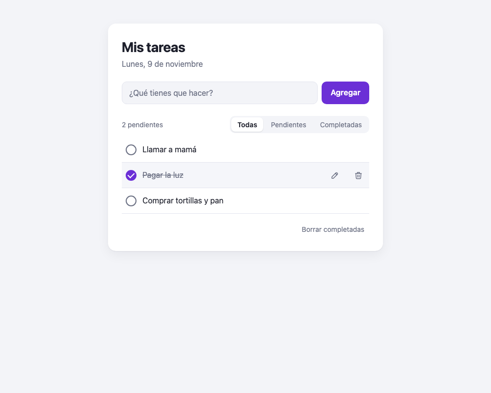
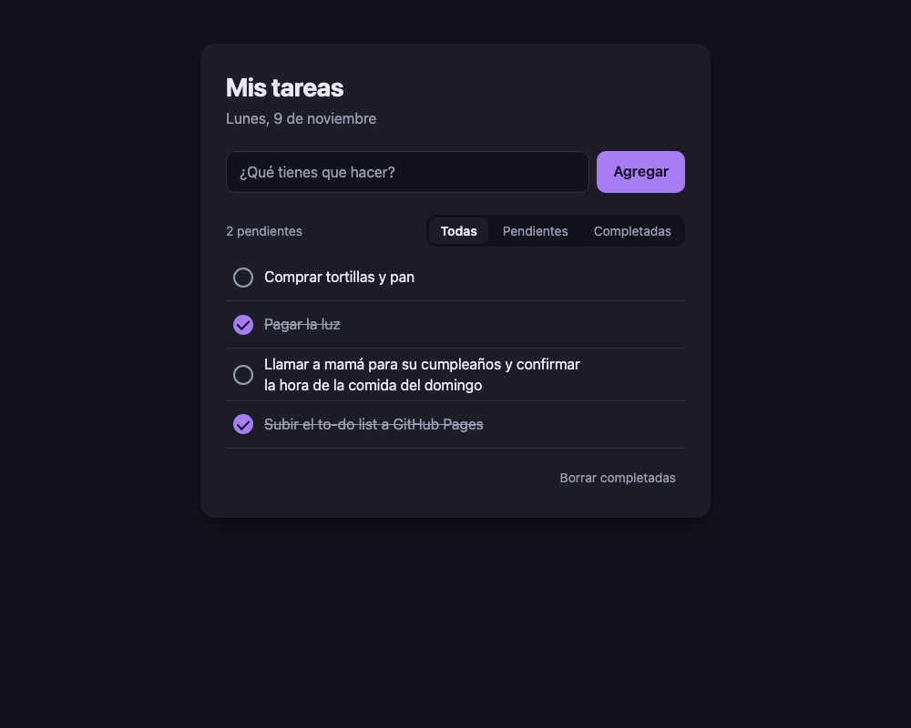
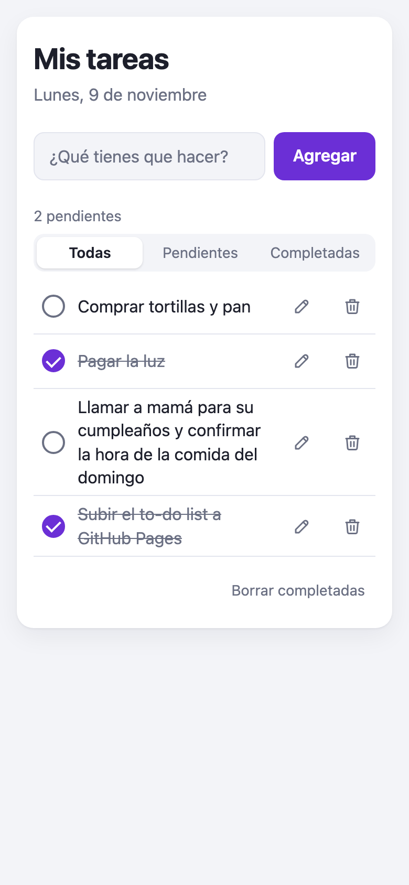

# Lista de tareas (JavaScript puro)

Lista de tareas sencilla hecha con **HTML, CSS y JavaScript**, sin frameworks ni dependencias.

**Demo:** https://ifee09.github.io/to-do-list-simple-javascript/



## Qué hace

- **Agregar** tareas con el botón o con <kbd>Enter</kbd> (los espacios en blanco no cuentan).
- **Completar** con la casilla redonda; la tarea se tacha.
- **Editar** con doble clic sobre el texto o con el lápiz: <kbd>Enter</kbd> guarda y <kbd>Esc</kbd> cancela.
- **Eliminar** con el bote de basura, o **borrar todas las completadas** de una vez.
- **Filtrar** entre Todas, Pendientes y Completadas, con un contador de pendientes.
- **Se guardan solas** en el navegador (`localStorage`): siguen ahí al recargar la página.
- **Modo oscuro** automático y **diseño para celular** (en pantallas táctiles los botones siempre están visibles).
- **Accesible:** se usa con teclado, con etiquetas para lectores de pantalla y foco visible.

| Modo oscuro | Celular |
|---|---|
|  |  |

## Cómo está hecho

```
index.html   Estructura y plantilla <template> de cada tarea
styles.css   Estilos con variables de color para modo claro y oscuro
script.js    Datos, dibujado de la lista y eventos
assets/      Favicon
docs/        Capturas del README
```

- Cada tarea es un objeto `{ id, text, done }` dentro de un arreglo; cada cambio guarda el arreglo y vuelve a dibujar la lista (`update()` → `saveTasks()` + `render()`).
- La lista usa **delegación de eventos**: un solo listener en el `<ul>` atiende las casillas, los botones y el doble clic de todas las tareas.
- El texto se inserta con `textContent`, así que lo que escribe el usuario nunca se interpreta como HTML.

## Verlo en local

Abre `index.html` en el navegador, o sirve la carpeta:

```bash
python3 -m http.server 8000
# http://localhost:8000
```
